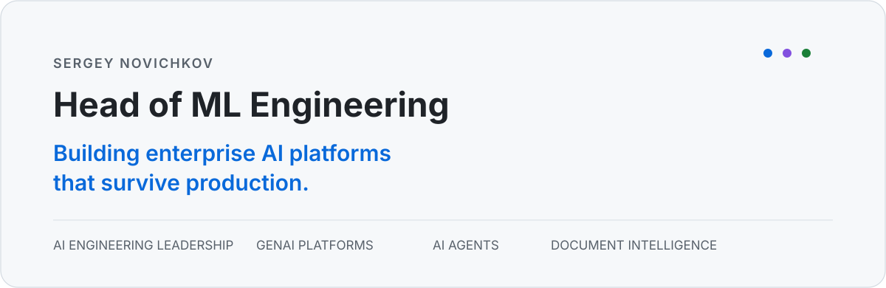
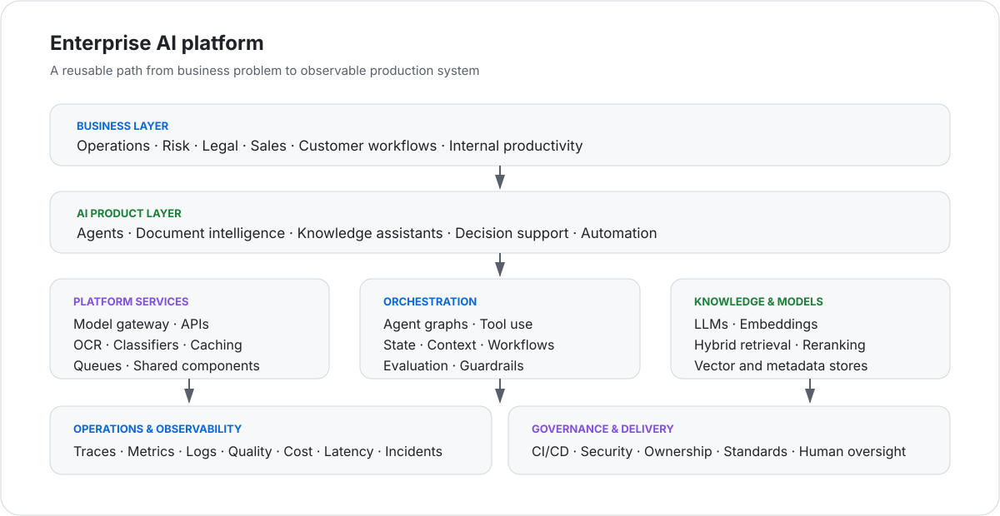

<picture>
  <source media="(prefers-color-scheme: dark)" srcset="./assets/hero-dark.svg">
  <source media="(prefers-color-scheme: light)" srcset="./assets/hero-light.svg">
  
</picture>

 

---

## Engineering AI for production

I lead ML engineering teams and build enterprise AI platforms for regulated, document-heavy business workflows.

My work sits at the intersection of **engineering leadership**, **GenAI platform architecture**, and **hands-on delivery**: from OCR and retrieval to AI agents, observability, deployment, and operating models that help teams ship reliable AI systems faster.

> **Production AI is an engineering discipline — not a demo.**

<table>
  <tr>
    <td align="center"><strong>7</strong> engineers led</td>
    <td align="center"><strong>22</strong> production AI services</td>
    <td align="center"><strong>4×</strong> faster PoC cycle</td>
    <td align="center"><strong>₽600M+</strong> business impact</td>
  </tr>
</table>

Selected figures are rounded and describe business outcomes across enterprise initiatives.

---

## What I build

| Area | Engineering focus |
|---|---|
| **Enterprise AI platforms** | Shared services, model access, reusable components, deployment standards, governance |
| **AI agents** | Stateful workflows, tool use, orchestration, context management, human-in-the-loop controls |
| **Document intelligence** | OCR, layout-aware parsing, classification, table understanding, long-document processing |
| **Retrieval and search** | Hybrid retrieval, reranking, embeddings, vector search, grounded generation |
| **AI observability** | Tracing, evaluation, quality metrics, cost and latency monitoring, incident diagnostics |
| **ML platform engineering** | Kubernetes, CI/CD, service reliability, APIs, asynchronous processing, data infrastructure |

---

## How I think about AI engineering

<table>
  <tr>
    <td width="50%" valign="top">
      <h3>Business before models</h3>
      Technology matters when it creates measurable value, reduces risk, or changes how a business operates.
    </td>
    <td width="50%" valign="top">
      <h3>Platforms over one-offs</h3>
      Reusable capabilities create leverage. A good platform makes the next AI product cheaper and faster to build.
    </td>
  </tr>
  <tr>
    <td width="50%" valign="top">
      <h3>Reliability is a feature</h3>
      Production systems need predictable behavior, graceful failure modes, clear ownership, and operational discipline.
    </td>
    <td width="50%" valign="top">
      <h3>Observability by default</h3>
      Every important decision should be traceable. Quality, latency, cost, and failures must be visible.
    </td>
  </tr>
  <tr>
    <td width="50%" valign="top">
      <h3>Teams are the scaling mechanism</h3>
      Architecture alone does not scale an organization. Standards, mentoring, feedback, and ownership do.
    </td>
    <td width="50%" valign="top">
      <h3>Pragmatism wins</h3>
      The best solution balances quality, delivery speed, maintainability, security, and business constraints.
    </td>
  </tr>
</table>

---

## Enterprise AI platform view

<picture>
  <source media="(prefers-color-scheme: dark)" srcset="./assets/architecture-dark.svg">
  <source media="(prefers-color-scheme: light)" srcset="./assets/architecture-light.svg">
  
</picture>

---

## Selected engineering work

### Enterprise document intelligence

A production ecosystem for processing complex business documents: OCR, text-layer extraction, classification, archive handling, table interpretation, contract analysis, and downstream LLM workflows.

**Focus:** scalable APIs · batch processing · long documents · structured outputs · operational reliability

### Agentic knowledge and workflow systems

Production AI agents connected to enterprise knowledge and business tools, with explicit orchestration, session state, retrieval, evaluation, and traceability.

**Focus:** LangGraph-style workflows · tool calling · RAG · context management · human oversight

### LLM and ML observability

A shared observability layer for production AI services, combining traces, quality evaluation, operational logs, infrastructure metrics, and incident investigation.

**Focus:** Langfuse · MLflow · OpenTelemetry · Graylog · Grafana · ClickHouse

### Compliance and risk automation

ML and rule-based systems for identifying sensitive data and embedding automated controls into document and data-processing pipelines.

**Focus:** PII detection · classification · auditability · quality thresholds · regulated environments

> Most enterprise source code is private. The descriptions above are intentionally generalized and contain no proprietary architecture, data, or implementation details.

---

## Public work

<table>
  <tr>
    <td width="50%" valign="top">
      <h3><a href="https://github.com/xEnotWhyNotx/FinalGigaWin2025">FinalGigaWin2025</a></h3>
      Full-stack AI solution with a Python backend, TypeScript frontend, containerized deployment, HTTPS configuration, and production-oriented documentation.
        
      Python · TypeScript · Docker · Nginx · ML
    </td>
    <td width="50%" valign="top">
      <h3><a href="https://github.com/xEnotWhyNotx/100DaysOfDataScience">100DaysOfDataScience</a></h3>
      A structured collection of applied data science and machine learning materials built during an intensive learning challenge.
        
      Python · Jupyter · Machine Learning · Data Science
    </td>
  </tr>
  <tr>
    <td width="50%" valign="top">
      <h3><a href="https://github.com/xEnotWhyNotx/nlp-ner-python">nlp-ner-python</a></h3>
      Experiments and practical work focused on natural language processing, entity recognition, and text analytics.
        
      NLP · NER · Python · Jupyter
    </td>
    <td width="50%" valign="top">
      <h3><a href="https://github.com/xEnotWhyNotx/online-shop">online-shop</a></h3>
      An earlier Telegram marketplace project built with Python, Aiogram, and SQLite.
        
      Python · Aiogram · SQLite · Telegram
    </td>
  </tr>
</table>

---

## Technology

**AI systems**  
LLMs · AI agents · RAG · hybrid retrieval · reranking · embeddings · OCR · NLP · evaluation

**Frameworks**  
LangChain · LangGraph · PyTorch · scikit-learn · FastAPI · Flask

**Platform**  
Python · Docker · Kubernetes · GitLab CI/CD · Linux · asynchronous services · REST APIs

**Data**  
PostgreSQL · pgvector · ClickHouse · FAISS · RabbitMQ · Kafka

**Observability**  
Langfuse · MLflow · OpenTelemetry · Grafana · Graylog · Prometheus

---

## Leadership

- Lead a team of ML engineers across hiring, mentoring, performance, architecture, delivery, and production ownership.
- Translate ambiguous business problems into platform capabilities, technical roadmaps, and measurable outcomes.
- Establish engineering standards for service design, logging, observability, deployment, and quality evaluation.
- Work hands-on when architectural decisions, complex incidents, or critical delivery risks require it.

---

## Education

**HSE University** — Master's degree, Digital Product Management  
**RTU MIREA** — Bachelor's degree, Applied Mathematics, graduated with honors

---

### Building reliable AI systems that create measurable business value.

[LinkedIn](https://www.linkedin.com/in/xEnotWhyNotx/) ·
[Telegram](https://t.me/xEnotWhyNotx) ·
[Email](mailto:novichkovSD@ya.ru) ·
[English CV](./CV-EN.pdf)

