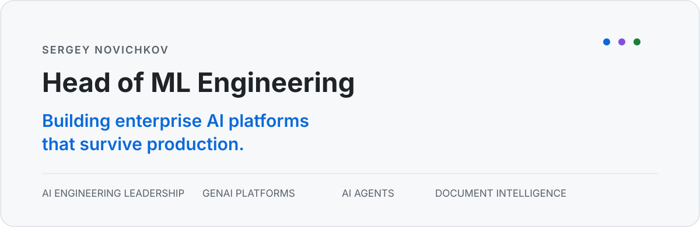

<picture>
  <source media="(prefers-color-scheme: dark)" srcset="./assets/hero-dark.svg">
  <source media="(prefers-color-scheme: light)" srcset="./assets/hero-light.svg">
  
</picture>

 

---

## Engineering AI for production

I am a **Head of Machine Learning** leading ML engineering teams and building enterprise AI platforms for complex, document-heavy business workflows.

My work combines engineering leadership, AI platform architecture, and hands-on delivery — from OCR, retrieval, and document intelligence to LLM applications, AI agents, observability, and production operations.

I focus on turning business problems into reliable systems that can be operated, measured, and scaled — not just demonstrated.
Generated approximately $2.4M in total annual business impact across the AI team's portfolio, including an NLP-based personal data detection solution delivering $590K annually.

> **Production AI is an engineering discipline — not a demo.**

<table>
  <tr>
    <td align="center"><strong>9+</strong> direct reports</td>
    <td align="center"><strong>37</strong> services</td>
    <td align="center"><strong>2</strong> platforms</td>
    <td align="center"><strong>$2.4M</strong> annual business impact</td>
  </tr>
  <tr>
    <td align="center"><strong>8+</strong> business units</td>
    <td align="center"><strong>160+</strong> employees supported</td>
    <td align="center"><strong>20+</strong> OCR integrations</td>
    <td align="center"><strong>5–6K</strong> files processed daily</td>
  </tr>
</table>

Figures describe the current enterprise portfolio and selected product outcomes; they are not additive measures of one project.

---

## What I build

| Area | Engineering focus |
|---|---|
| **Enterprise AI platforms** | Shared services, model access, reusable components, deployment standards, governance |
| **AI agents and workflows** | Tool use, orchestration, session state, context management, human-in-the-loop controls |
| **Document intelligence** | OCR, text extraction, classification, table understanding, archive processing, long-document analysis |
| **Retrieval and search** | Embeddings, vector search, hybrid retrieval, reranking, grounded generation |
| **AI observability** | Tracing, evaluation, quality metrics, cost and latency monitoring, incident diagnostics |
| **ML platform engineering** | Kubernetes, CI/CD, service reliability, APIs, asynchronous processing, data infrastructure |

---

## Selected engineering work

### Contract and document intelligence

Built and lead a production ecosystem for complex business documents: OCR, text-layer extraction, classification, archive validation, table interpretation, and contract analysis.

- **ContractAnalysis:** processes document packages of up to 1,500 pages in approximately 22 minutes.
- **92%** of analyses meet the defined ideal-quality criterion.
- **DocPacker:** checks document-package completeness before contract analysis.
- Designed the processing flow around production constraints, including model capacity, GPU availability, and operational reliability.

**Focus:** OCR · VLMs · document parsing · long-context LLMs · batch processing · structured outputs

### OCR as a shared capability

Developed a shared OCR capability used by **20+ services**, processing approximately **5,000–6,000 files per day**.

The solution supports multiple document-processing scenarios and provides a common integration layer for downstream ML and AI services. Current rejection rate is approximately **0.4%**, primarily associated with VLM OCR limitations.

**Focus:** OCR orchestration · text extraction · VLM integration · service APIs · throughput · reliability

### Personal data detection and compliance automation

Led the development of an automated personal-data detection capability embedded in business document and data-processing workflows.

The solution contributes to **$590K in annual combined business impact** across the relevant processes. It supports recurring quarterly audit cycles and flags potentially sensitive data for review.

**Focus:** PII detection · classification · auditability · automated controls · regulated workflows

### Table understanding and data preparation

Developed TableDesc to automate table annotation and description in data-protection workflows.

The service currently automates approximately **70% of table annotation**; the remaining cases go through human verification. Full autonomy is a further development target, not a current production claim.

**Focus:** table understanding · structured extraction · human-in-the-loop · quality controls

### LLM applications and agentic workflows

Lead production LLM, RAG, and agent-based applications used by **60+ employees** across client management, credit analysis, analytics, development, verification, and supply-related workflows.

The portfolio includes knowledge assistants and workflow agents with tool calling, retrieval, session context, and human validation where required.

**Focus:** LLM applications · RAG · tool calling · workflow orchestration · evaluation · human oversight

### AI and ML observability

Established a shared observability approach for production AI services, combining traces, quality evaluation, operational logs, infrastructure metrics, and incident investigation.

**Focus:** Langfuse · MLflow · OpenTelemetry · Graylog · Grafana · ClickHouse

> Most enterprise source code is private. These descriptions are intentionally generalized and contain no proprietary architecture, data, or implementation details.

---

## Engineering impact

| Outcome | Result |
|---|---:|
| Annual combined business impact across the AI team's portfolio | **$2.4M** |
| Contract analysis quality meeting the defined ideal-quality criterion | **92%** |
| Maximum processed contract package size observed in production | **1,500 pages** |
| Typical processing time for large contract packages | **~22 minutes** |
| Automated table annotation | **70%** |
| OCR integrations across services | **20+** |
| Daily OCR throughput | **5,000–6,000 files** |
| Improvement in service uptime / resilience | **+20%** |
| Improvement in processing performance through pipeline optimization | **+45%** |

Metrics refer to different services and measurement scopes. Quality, throughput, uptime, and performance figures should be interpreted according to each product's own measurement methodology.

---

## Leadership

I lead the ML engineering function and coordinate delivery across the wider AI and infrastructure landscape.

- Lead **9+ direct reports** across ML engineering and analysis; coordinate an additional four-person infrastructure function.
- Own hiring, onboarding, mentoring, performance reviews, team development, and workload balancing.
- Set technical direction and review architecture, code quality, service design, and production readiness.
- Plan and prioritize work across business requests, platform capabilities, and operational commitments.
- Manage team and infrastructure budgets, procurement, hiring approvals, and resource allocation.
- Work with business stakeholders, architects, security, and platform teams to align scope, risks, dependencies, and expected outcomes.
- Establish engineering processes from the ground up: delivery standards, documentation, release management, observability, and incident practices.
- Present solutions and defend business impact; remain hands-on in critical architecture and delivery decisions.

---

## How I think about AI engineering

<table>
  <tr>
    <td width="50%" valign="top">
      <h3>Business before models</h3>
      Technology matters when it creates measurable value, reduces risk, or changes how a business operates.
    </td>
    <td width="50%" valign="top">
      <h3>Platforms over one-offs</h3>
      Reusable capabilities create leverage. A good platform makes the next AI product cheaper and faster to build.
    </td>
  </tr>
  <tr>
    <td width="50%" valign="top">
      <h3>Reliability is a feature</h3>
      Production systems need predictable behavior, graceful failure modes, clear ownership, and operational discipline.
    </td>
    <td width="50%" valign="top">
      <h3>Observability by default</h3>
      Quality, latency, cost, and failures must be visible. Important decisions should be traceable.
    </td>
  </tr>
  <tr>
    <td width="50%" valign="top">
      <h3>Teams are the scaling mechanism</h3>
      Architecture alone does not scale an organization. Standards, mentoring, feedback, and ownership do.
    </td>
    <td width="50%" valign="top">
      <h3>Pragmatism wins</h3>
      The best solution balances quality, delivery speed, maintainability, security, and business constraints.
    </td>
  </tr>
</table>

---

## Technology

**AI systems**  
LLMs · AI agents · RAG · hybrid retrieval · reranking · embeddings · OCR · VLMs · NLP · evaluation

**Frameworks**  
LangChain · LangGraph · PyTorch · scikit-learn · FastAPI · Flask

**Platform**  
Python · Docker · Kubernetes · GitLab CI/CD · Linux · asynchronous services · REST APIs

**Data and messaging**  
PostgreSQL · pgvector · ClickHouse · FAISS · RabbitMQ · Kafka

**Observability**  
Langfuse · MLflow · OpenTelemetry · Grafana · Graylog · Prometheus

---

## Experience

### Sberbank Factoring
**Head of Machine Learning** · 2023–present

Joined as a Middle ML Engineer, progressed to Senior ML Engineer, and took on formal ML leadership responsibilities in December 2025.

Lead the ML engineering function and enterprise AI delivery across a portfolio of 37 services and two platforms. Responsible for team development, architecture, delivery, production standards, stakeholder alignment, and measurable business outcomes.

### Proscom / SalaryScan
**Machine Learning Engineer · Team Lead responsibilities** · 2021–2023

Led a five-person team during the final stage of the role and delivered ML products for recruitment and salary analytics.

- Increased resume-processing throughput from approximately **1,700 to 10,000+ resumes per day**.
- Improved recommendation-driven conversion from **10% to 47%**.
- Reduced manual annotation effort by **80%**.
- Reduced time to production by **25%**.
- Reduced salary prediction MAE from **₽12.4K to ₽10.2K**.

---

## Public work

<table>
  <tr>
    <td width="50%" valign="top">
      <h3><a href="https://github.com/xEnotWhyNotx/FinalGigaWin2025">FinalGigaWin2025</a></h3>
      Full-stack AI solution with a Python backend, TypeScript frontend, containerized deployment, HTTPS configuration, and production-oriented documentation.
        
      Python · TypeScript · Docker · Nginx · ML
    </td>
    <td width="50%" valign="top">
      <h3><a href="https://github.com/xEnotWhyNotx/100DaysOfDataScience">100DaysOfDataScience</a></h3>
      A structured collection of applied data science and machine learning materials built during an intensive learning challenge.
        
      Python · Jupyter · Machine Learning · Data Science
    </td>
  </tr>
  <tr>
    <td width="50%" valign="top">
      <h3><a href="https://github.com/xEnotWhyNotx/nlp-ner-python">nlp-ner-python</a></h3>
      Experiments and practical work focused on natural language processing, entity recognition, and text analytics.
        
      NLP · NER · Python · Jupyter
    </td>
    <td width="50%" valign="top">
      <h3><a href="https://github.com/xEnotWhyNotx/online-shop">online-shop</a></h3>
      An earlier Telegram marketplace project built with Python, Aiogram, and SQLite.
        
      Python · Aiogram · SQLite · Telegram
    </td>
  </tr>
</table>

---

## Education

**HSE University** — Master's studies, Digital Product Management  
**RTU MIREA** — Bachelor's degree, Applied Mathematics, graduated with honors

---

## Languages

**Russian** — Native  
**English** — B1

---

### Building reliable AI systems that create measurable business value.

[LinkedIn](https://www.linkedin.com/in/xEnotWhyNotx/) ·
[Telegram](https://t.me/xEnotWhyNotx) ·
[Email](mailto:novichkovSD@ya.ru) ·
[English CV](./CV-EN.pdf)

